

<picture><source media="(prefers-color-scheme: dark)" srcset="assets/hero-dark.svg"></picture>

<picture><source media="(prefers-color-scheme: dark)" srcset="assets/social-l-dark.svg"></picture><a href="https://t.me/YouShades"><picture><source media="(prefers-color-scheme: dark)" srcset="assets/social-1-dark.svg"></picture></a><a href="https://discord.com/bapB8zz7VY"><picture><source media="(prefers-color-scheme: dark)" srcset="assets/social-2-dark.svg"></picture></a><picture><source media="(prefers-color-scheme: dark)" srcset="assets/social-r-dark.svg"></picture>

<picture><source media="(prefers-color-scheme: dark)" srcset="assets/stats-dark.svg"></picture>

<picture><source media="(prefers-color-scheme: dark)" srcset="assets/about-dark.svg"></picture>

<picture><source media="(prefers-color-scheme: dark)" srcset="assets/stack-dark.svg"></picture>

<a href="https://github.com/WollyDev24/YouShade"><picture><source media="(prefers-color-scheme: dark)" srcset="assets/project-youshade-dark.svg"></picture></a>&nbsp;<a href="https://github.com/WollyDev24/Astra"><picture><source media="(prefers-color-scheme: dark)" srcset="assets/project-astra-dark.svg"></picture></a>

<a href="https://github.com/WollyDev24/Sharky"><picture><source media="(prefers-color-scheme: dark)" srcset="assets/project-sharky-dark.svg"></picture></a>&nbsp;<a href="https://github.com/WollyDev24/UselessPyScripts"><picture><source media="(prefers-color-scheme: dark)" srcset="assets/project-uselesspyscripts-dark.svg"></picture></a>

<picture><source media="(prefers-color-scheme: dark)" srcset="assets/streak-dark.svg"></picture>

<picture><source media="(prefers-color-scheme: dark)" srcset="assets/wave-dark.svg"></picture>

<a href="https://wolly.is-a.dev/"><picture><source media="(prefers-color-scheme: dark)" srcset="assets/button-1-dark.svg"></picture></a>&nbsp;&nbsp;<a href="https://github.com/WollyDev24?tab=repositories"><picture><source media="(prefers-color-scheme: dark)" srcset="assets/button-2-dark.svg"></picture></a>

<a href="https://metawka.github.io/expressive-profile/?from=WollyDev24"><picture><source media="(prefers-color-scheme: dark)" srcset="assets/credit-dark.svg"></picture></a>

